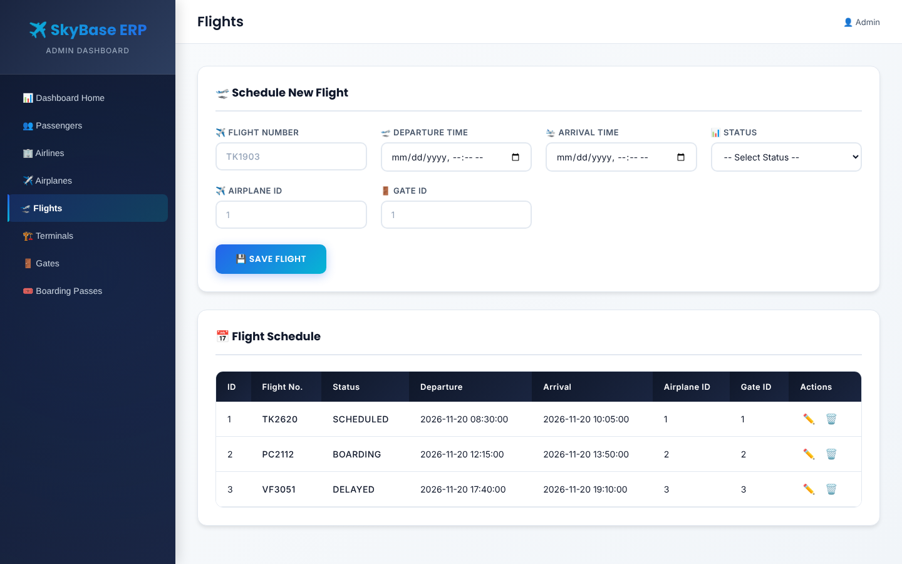
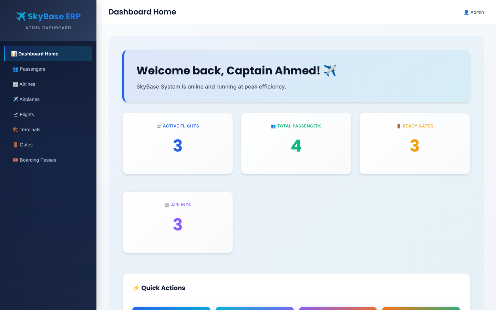

# Airport Management System

A full-stack airport management app: a **Spring Boot REST API** backed by **PostgreSQL**, and **SkyBase ERP**, an HTML/CSS/JavaScript admin dashboard that consumes it. It manages airlines, airplanes, terminals, gates, flights, passengers and boarding passes.

   



<sub>Screenshots use sample data.</sub>

## Video presentation

A walkthrough of the project's web services, in English:

<a href="https://youtu.be/d71DbnL-1-I"></a>

## What it does

- **Full CRUD for 7 resources**, each with its own controller, service and repository
- **Batch inserts** – every resource has a `POST /{resource}/saveAll` endpoint that writes a list in one `JdbcTemplate.batchUpdate` call
- **Validation in the service layer** – bad input throws an `IllegalArgumentException`, which a global `@ControllerAdvice` turns into a clean `400 Bad Request`
- **Hand-written SQL** with `JdbcTemplate` and `RowMapper`s, so every query is explicit
- **Tables created from the entities** – models are JPA `@Entity` classes, and Hibernate creates the schema on startup
- **OpenAPI documentation** – models are annotated with `@Schema`, and Swagger UI lets you try every endpoint
- **Admin dashboard** – live counts, a page per resource with add / edit / delete and instant search

## Architecture

```
SkyBase dashboard (HTML/CSS/JS) ──fetch / JSON──▶ Controller ──▶ Service (validation) ──▶ Repository (JdbcTemplate + SQL) ──▶ PostgreSQL
                                                     │
                                                     └── GlobalExceptionHandler  →  400 Bad Request with a readable message
```

```
├── frontend/
│   ├── login.html        login screen (demo only – see below)
│   └── PageMain.html     SkyBase ERP dashboard
├── docs/                 screenshots
└── src/main/java/com/airport/management
    ├── Controller/       REST endpoints (one per resource)
    ├── Service/          business rules and validation
    ├── Repository/       SQL queries with JdbcTemplate
    ├── Model/            Airline, Airplane, Terminal, Gate, Flight, Passenger, BoardingPass
    └── Exception/        GlobalExceptionHandler
```

## Data model

```
airlines ──< airplanes ──< flights >── gates >── terminals
                              │
passengers ──< boarding_passes >┘
```

## API

Each resource below supports the same five endpoints:

| Method | Path | Description |
|---|---|---|
| GET | `/{resource}` | List all |
| POST | `/{resource}` | Create one |
| POST | `/{resource}/saveAll` | Create many (batch insert) |
| PUT | `/{resource}/{id}` | Update |
| DELETE | `/{resource}/{id}` | Delete |

Resources: `airlines`, `airplanes`, `terminals`, `gates`, `flights`, `passengers`, `boarding-passes`

```bash
curl -X POST http://localhost:8080/airlines \
  -H "Content-Type: application/json" \
  -d '{"name": "Turkish Airlines", "code": "TK"}'
```

## Run it locally

**Requirements:** Java 21, PostgreSQL (Maven wrapper included)

```bash
# 1. Create the database
createdb airport_management_db

# 2. Give it your credentials – environment variables...
export DB_USERNAME=postgres
export DB_PASSWORD=your_password
#    ...or a git-ignored file: src/main/resources/application-local.properties
#    spring.datasource.password=your_password

# 3. Start the API (tables are created automatically)
./mvnw spring-boot:run
```

- API docs: **http://localhost:8080/airport-docs**
- Dashboard: open `frontend/login.html` in your browser

> The login screen is a front-end demo only (`admin` / `123`, checked in JavaScript). The API itself has no authentication yet.



## Tech stack

Java 21 · Spring Boot 4 · Spring Web MVC · Spring JDBC (JdbcTemplate) · Spring Data JPA / Hibernate (schema) · PostgreSQL · springdoc-openapi (Swagger UI) · HTML · CSS · JavaScript · Maven

## Author

**Ahmed Al-Gabri** – Computer Engineering student, Bingöl University  
[LinkedIn](https://www.linkedin.com/in/ahmed-al-gabri) · [GitHub](https://github.com/ah24aki)
